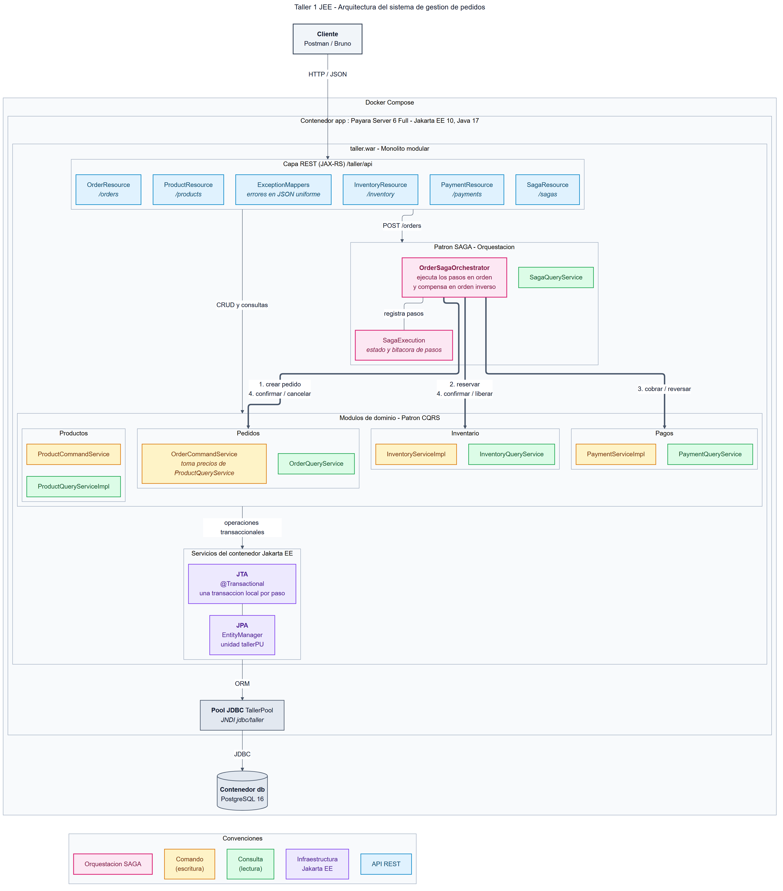
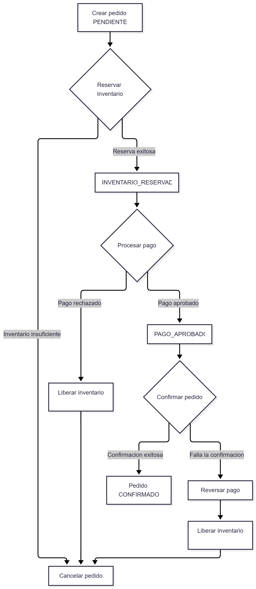

# Sistema de Gestión de Pedidos con Jakarta EE

Aplicación empresarial para gestionar productos, inventario, pedidos y pagos. Implementa **JPA**, **JTA**, **CQRS** y el patrón **SAGA por orquestación**, incluyendo operaciones compensatorias ante fallos.

## Tecnologías

- Java 17
- Jakarta EE 10
- Payara Server 6
- JPA
- JTA
- CDI
- JAX-RS
- PostgreSQL 16
- Maven
- Docker y Docker Compose
- JUnit 5 y Mockito

## Arquitectura

La aplicación utiliza una arquitectura de **monolito modular**, desplegada como un único archivo WAR en Payara Server.

Los módulos se comunican internamente mediante interfaces y servicios CDI. REST se utiliza únicamente como API externa.

```text
co.edu.javeriana.pedidos
├── productos
│   ├── command
│   ├── query
│   ├── model
│   └── dto
├── inventario
│   ├── command
│   ├── query
│   ├── model
│   └── dto
├── pedidos
│   ├── command
│   ├── query
│   ├── model
│   └── dto
├── pagos
│   ├── command
│   ├── query
│   ├── model
│   └── dto
├── saga
│   ├── orchestrator
│   ├── model
│   ├── query
│   └── dto
├── shared
│   ├── contract
│   └── exception
└── api
    ├── resource
    ├── request
    ├── response
    └── exception
```

### Diagrama de arquitectura



## CQRS

Las operaciones de escritura y lectura se encuentran separadas:

- Los paquetes `command` contienen los servicios que modifican información.
- Los paquetes `query` contienen servicios dedicados exclusivamente a consultas.
- Los DTO de lectura son diferentes de las entidades JPA utilizadas para escritura y persistencia.

Esta separación se aplica en los módulos de productos, inventario, pedidos y pagos.

## SAGA por orquestación

La compra se coordina desde `OrderSagaOrchestrator`.

Se eligió la **orquestación** porque existe un componente central que conoce el orden de los pasos, actualiza el avance de la SAGA y ejecuta las compensaciones cuando ocurre un fallo.

El flujo exitoso es:

1. Registrar el pedido en estado `PENDIENTE`.
2. Consultar los productos y guardar sus precios.
3. Reservar el inventario.
4. Cambiar el pedido a `INVENTARIO_RESERVADO`.
5. Procesar el pago.
6. Cambiar el pedido a `PAGO_APROBADO`.
7. Confirmar el pedido.
8. Finalizar la SAGA en estado `COMPLETED`.

### Flujo y compensaciones



Las compensaciones implementadas son:

| Fallo | Compensación |
|---|---|
| Inventario insuficiente | Cancelar el pedido sin procesar el pago |
| Pago rechazado | Liberar el inventario y cancelar el pedido |
| Fallo al confirmar el pedido | Reversar el pago, liberar el inventario y cancelar el pedido |

Las operaciones de liberación de inventario y reversión de pagos son idempotentes. Ejecutarlas más de una vez no duplica el inventario ni genera múltiples reversiones.

## Transacciones JTA

La compra completa no se ejecuta como una única transacción, porque eso mantendría bloqueados los recursos durante todo el proceso.

Cada paso de la SAGA utiliza una transacción JTA administrada por Payara. Entre otras operaciones:

- La reserva valida el inventario, descuenta las existencias y registra la reserva atómicamente.
- El procesamiento del pago registra su resultado de forma transaccional.
- Los cambios del pedido y el avance de la SAGA se almacenan consistentemente.
- Si un paso falla, su transacción se revierte y el orquestador ejecuta las compensaciones necesarias.

## Estados

### Pedido

```text
PENDIENTE
INVENTARIO_RESERVADO
PAGO_APROBADO
CONFIRMADO
CANCELADO
```

### Pago

```text
PENDIENTE
APROBADO
RECHAZADO
REVERSADO
```

### Reserva

```text
ACTIVA
LIBERADA
```

### SAGA

```text
IN_PROGRESS
COMPLETED
COMPENSATING
COMPENSATED
FAILED
```

## Ejecución con Docker

### Requisitos

- Docker Desktop
- Docker Compose

### Iniciar la aplicación

```bash
docker compose up -d --build
```

El primer build puede tardar varios minutos mientras se descargan las imágenes y dependencias.

Comprobar los contenedores:

```bash
docker compose ps
```

Los servicios disponibles son:

| Servicio | Dirección |
|---|---|
| API REST | `http://localhost:8081/taller/api` |
| Consola de Payara | `http://localhost:4848` |
| Health check | `http://localhost:8081/taller/api/health` |

En PowerShell, el estado de la aplicación se puede comprobar con:

```powershell
Invoke-RestMethod http://localhost:8081/taller/api/health
```

Respuesta esperada:

```json
{
  "status": "UP"
}
```

### Detener la aplicación

```bash
docker compose down
```

Para eliminar también los datos almacenados en PostgreSQL:

```bash
docker compose down -v
```

## Ejecución de pruebas

Para compilar el proyecto y ejecutar las pruebas:

```bash
mvn clean test
```

Las pruebas verifican productos, inventario, pagos, pedidos, idempotencia y los diferentes resultados de la SAGA.

## API REST

URL base:

```text
http://localhost:8081/taller/api
```

### Productos

| Método | Endpoint | Descripción |
|---|---|---|
| POST | `/products` | Registrar un producto |
| GET | `/products` | Consultar todos los productos |
| GET | `/products/{id}` | Consultar un producto |
| PUT | `/products/{id}/price` | Actualizar el precio |
| PUT | `/products/{id}/stock` | Actualizar el inventario |
| PUT | `/products/{id}/availability` | Activar o desactivar un producto |

Ejemplo de creación:

```json
{
  "name": "Teclado mecánico",
  "price": 150000,
  "stock": 10
}
```

### Inventario

| Método | Endpoint | Descripción |
|---|---|---|
| GET | `/inventory` | Consultar el inventario |
| GET | `/inventory/{productId}` | Consultar el inventario de un producto |
| GET | `/inventory/reservations/{orderId}` | Consultar la reserva de un pedido |
| POST | `/inventory/reservations` | Probar una reserva directamente |
| DELETE | `/inventory/reservations/{orderId}` | Liberar una reserva |

### Pedidos

| Método | Endpoint | Descripción |
|---|---|---|
| POST | `/orders` | Crear y procesar un pedido |
| GET | `/orders` | Consultar todos los pedidos |
| GET | `/orders/{id}` | Consultar un pedido |

Ejemplo de pedido exitoso:

```json
{
  "customerId": "CLIENTE-001",
  "items": [
    {
      "productId": 1,
      "quantity": 2
    }
  ],
  "simulatePaymentFailure": false,
  "simulateConfirmationFailure": false
}
```

Para simular el rechazo del pago:

```json
{
  "customerId": "CLIENTE-PAGO-RECHAZADO",
  "items": [
    {
      "productId": 1,
      "quantity": 2
    }
  ],
  "simulatePaymentFailure": true,
  "simulateConfirmationFailure": false
}
```

Para simular un fallo posterior a la aprobación del pago:

```json
{
  "customerId": "CLIENTE-FALLO-CONFIRMACION",
  "items": [
    {
      "productId": 1,
      "quantity": 1
    }
  ],
  "simulatePaymentFailure": false,
  "simulateConfirmationFailure": true
}
```

Los campos de simulación son exclusivamente demostrativos y permiten comprobar las compensaciones de la SAGA.

### Pagos

| Método | Endpoint | Descripción |
|---|---|---|
| GET | `/payments` | Consultar los pagos |
| POST | `/payments` | Probar el procesamiento de un pago |
| DELETE | `/payments/{orderId}` | Reversar el pago de un pedido |

### SAGA

| Método | Endpoint | Descripción |
|---|---|---|
| GET | `/sagas/order/{orderId}` | Consultar la ejecución de la SAGA de un pedido |

## Manejo de errores

Los errores se entregan con una estructura JSON uniforme:

```json
{
  "code": "INSUFFICIENT_STOCK",
  "message": "Inventario insuficiente para el producto solicitado",
  "timestamp": "2026-10-08T17:28:38Z"
}
```

Algunos códigos HTTP utilizados son:

| Código | Situación |
|---|---|
| 400 | Datos de entrada inválidos |
| 402 | Pago rechazado |
| 404 | Producto, pedido o reserva inexistente |
| 409 | Inventario insuficiente o estado inválido |
| 500 | Error interno o fallo simulado de confirmación |

## Persistencia

La aplicación utiliza PostgreSQL 16 mediante un datasource administrado por Payara:

```text
JNDI: jdbc/taller
Unidad de persistencia: tallerPU
```

Las entidades se administran mediante JPA y las transacciones mediante JTA.

## Distribución del trabajo

### Rol 1

- Configuración base del proyecto.
- Docker Compose, Payara y PostgreSQL.
- Módulo de productos.
- Módulo de inventario.
- Diagrama base de arquitectura.

### Rol 2

- Manejo global de errores.
- Módulo de pagos.
- Módulo de pedidos.
- Orquestador SAGA.
- Operaciones compensatorias.
- API REST de pedidos, pagos y seguimiento de la SAGA.
- Pruebas de pagos y SAGA.
- Documentación del proyecto.

## Decisiones principales

- Monolito modular empaquetado como WAR.
- Payara 6 como servidor Jakarta EE.
- Comunicación interna mediante CDI.
- API externa mediante JAX-RS.
- CQRS para separar comandos y consultas.
- SAGA por orquestación.
- Una transacción JTA por cada paso.
- Compensaciones idempotentes.
- PostgreSQL como base de datos de ejecución.
- Docker Compose para un despliegue reproducible.